<picture>
  <source media="(prefers-color-scheme: dark)" srcset="assets/boot-night.svg">
  
</picture>

# FPGArtktic

I am a Kurp, from the [Kurpie](https://en.wikipedia.org/wiki/Kurpie) region
of Poland, and I keep its folk traditions. You can write to me at
[FPGArtktic@outlook.com](mailto:FPGArtktic@outlook.com).

I work on embedded systems and low-level software: FPGA programming, kernel
development, and building systems with Yocto and Buildroot. Day to day that
also means Bash, Podman and Python. I have worked in cybersecurity. I live in
Gdynia, Poland, and work as a freelancer.

A good deal of that work happens in air-gapped environments, where the
machine that runs the code has no network and the machine that builds it
does. That constraint decides the tooling: everything has to be fetched,
verified and packaged on one side, then carried across and work on the other
with nothing to fall back on. Several of the programs below exist for that
reason alone.

All of the software listed here is free software. Most of it is released
under the GNU GPL version 3; the exceptions are noted. Every one of these
programs exists because I wanted it on my own machine first, and I still use
them.

I use Arch, by the way.

The name FPGArtktic is assembled from the things it stands on: FPGA, the
hardware; ART, because I like art; K, for the kernel; and TIC, the clock
tick that drives all of it.

## Software

<picture>
  <source media="(prefers-color-scheme: dark)" srcset="assets/dir-night.svg">
  
</picture>

### Air-gapped work

* [gpygap](https://github.com/FPGArtktic/gpygap) — an offline PyPI mirror
  for air-gapped networks: the top 1000 projects plus your own packages,
  every dependency and extra, for several Python versions and platforms. It
  builds the wheels upstream never published while it still has a toolchain,
  verifies every package by installing it offline before shipping, and ships
  monthly deltas with checksums instead of a full copy each time.
  [Documentation](https://gpygap.readthedocs.io/).
* [AutoGit-o-Matic](https://github.com/FPGArtktic/AutoGit-o-Matic) — a POSIX
  shell script that fetches, pulls or safely fast-forwards many Git
  repositories at once, mirrors them with submodules, and exports git bundles
  for transfer across the gap. Runs unattended from cron or systemd. No
  runtime dependencies beyond sh and git; tested across four shells.
* [podman-wrk](https://github.com/FPGArtktic/podman_base) — builds a
  developer container on the machine that has a network, writes it to one
  file, and loads it on the machine that does not. Everything is fetched at
  build time, and the build fails if any of it did not land, because finding
  out what is missing on an air-gapped host is finding out too late. One
  shell script, one Containerfile. Public domain.

### Shell and system

* [GnuRAMage](https://github.com/FPGArtktic/GnuRAMage) — keeps a RAM disk
  (tmpfs) working set in step with persistent storage using rsync:
  RAM-speed I/O, nothing lost on power loss, project exclusions. Bash,
  checked with shellcheck.
* [setup-DotFiles](https://github.com/FPGArtktic/setup-DotFiles) — sets up a
  fresh workstation one question at a time: the packages, Docker, the SSH
  key, the dotfiles. The `arch` branch uses pacman and yay only; the Debian
  and Ubuntu versions live on their own branches.
* [mtsh](https://github.com/FPGArtktic/ohmyzsh-mtsh-theme) — a zsh prompt for
  multi-user machines that reports the state you would otherwise have to ask
  for: the clock, the host, where you are, and what git thinks of it. One
  frame per command, without making you wait for it.
* [dockd-cmake3dot5-git](https://aur.archlinux.org/packages/dockd-cmake3dot5-git)
  — my first AUR contribution: the Lenovo ThinkPad dock management daemon,
  packaged against the CMake version it actually needs.
  [Mirror on GitHub](https://github.com/FPGArtktic/AUR_dockd-cmake3dot5-git-).

### Local inference, local notes

Three programs that share one rule: nothing leaves the machine.

* [SHUTTLE](https://github.com/FPGArtktic/shuttle-stack) — a local-inference
  layer for coding agents. Your files are read by llama.cpp on your own
  hardware instead of being pushed into the agent's context. An MCP server,
  rootless Podman, no egress, cited answers, and every number in its README
  measured rather than asserted.
* [glosator](https://github.com/FPGArtktic/glosator) — turns a PDF textbook
  into sequential, linked Obsidian notes: one note per section, with a
  summary, a plain-language explanation, the formulas, the figures cropped
  from the page, a bilingual glossary and the pitfalls the source warns
  about. A glosator is the person who writes glosses on a difficult text.
* [tachygraf](https://github.com/FPGArtktic/tachygraf) — the sibling of
  glosator, for recordings instead of books. A recorded lecture becomes a
  verbatim transcript and a set of linked study notes, with a timestamp and
  a block ID on every paragraph, so every claim links back to the moment it
  was said. A tachygraf is the ancient shorthand clerk.

### FPGA

* [WEFT](https://github.com/FPGArtktic/weft-mcp) — WEFT Elaborates FPGA
  Toolchains: an MCP server that gives an LLM client a structured interface
  to an Intel Quartus Prime 25.1 flow. Lint and simulate in seconds, compile
  asynchronously, and read the results back as JSON instead of megabytes of
  log. Python, with its own CI, container build and
  [documentation](https://weft-mcp.readthedocs.io/en/main/).

### Embedded Linux

* [rtk-embedded-linux](https://github.com/FPGArtktic/rtk-embedded-linux) —
  filters for [rtk](https://github.com/rtk-ai/rtk) that cut what a coding
  agent reads from Yocto/BitBake and Buildroot builds, without hiding errors
  or where a build failed. One file works on the host, in Podman, in
  Apptainer and behind wrapper scripts. A full `core-image-minimal` build
  goes from 946 742 bytes to 496; a full Buildroot build becomes
  `buildroot: OK`. Comes with a measured evaluation of rtk itself, including
  what it loses and where it does not run. Measured on a
  [Raspberry Pi 4 reference build](https://github.com/FPGArtktic/rpi-yocto-buildroot-ref)
  in Yocto and Buildroot.

### Terminal tools

* [hyprtilt](https://github.com/FPGArtktic/hyprtilt) — a keyboard-first TUI
  and command line for arranging and rotating Hyprland monitors. It edits
  your own configuration in place inside a managed block, in both the Lua
  form and hyprlang. One static Rust binary, no daemon, no sidecar files.
* [LazySubmodules](https://github.com/FPGArtktic/lazysubmodules) — Git
  submodules that track branches, tags, tag patterns or fixed commits instead
  of only a detached SHA. A scriptable command line and an interactive TUI,
  with a lock file. Written in Go; `lsm` is the short name.

### Notes and the web

* [hugo-theme-c64-boot](https://github.com/FPGArtktic/hugo-theme-c64-boot) —
  the theme my website wears, and the source of the colours on this page. A
  Commodore 64 that has just been switched on: the page is the screen, the
  navigation is the 1541 disk directory with real block counts, and the
  errors are the ones the machine printed. No external requests, eight
  palettes, works without JavaScript. MIT, with the bundled fonts under the
  SIL Open Font License.
  [Demo](https://fpgartktic.github.io/hugo-theme-c64-boot/).
* [copilot-export-json-to-markdown](https://github.com/FPGArtktic/copilot-export-json-to-markdown)
  — converts a GitHub Copilot chat export into Markdown, as a script and as
  an Obsidian plugin. Archived; it does what it needs to.

### Downstream and reference

Forks I keep for my own reference and builds, not projects of mine:
[musl](https://github.com/FPGArtktic/musl),
[elixir](https://github.com/FPGArtktic/elixir) (and a
[self-hosted setup](https://github.com/FPGArtktic/elixir-cross-referencer-selfhosted)
for it),
[ohmyzsh](https://github.com/FPGArtktic/ohmyzsh),
[Quartus21_Ubuntu](https://github.com/FPGArtktic/Quartus21_Ubuntu),
[YoctoTutorials](https://github.com/FPGArtktic/YoctoTutorials).

## Reading

A list of books, sites and course material I have found worth the time is
kept on my website: [Interesting Links](https://fpgartktic.github.io/links/).

## Contact

* Website: [fpgartktic.github.io](https://fpgartktic.github.io/)
* E-mail: [FPGArtktic@outlook.com](mailto:FPGArtktic@outlook.com)
* YouTube: [kayaking, recorded](https://www.youtube.com/channel/UCZ4LH0jrgK2l0PJ-q9K6hTA/videos)

I am open to collaboration.

Outside work: kayaking, biblical studies and theology, music and poetry,
birds and feathers.

---

Not affiliated with Commodore. The colours are the `nice-city` and
`nice-night` palettes of hugo-theme-c64-boot, derived from the Colodore C64
palette.
